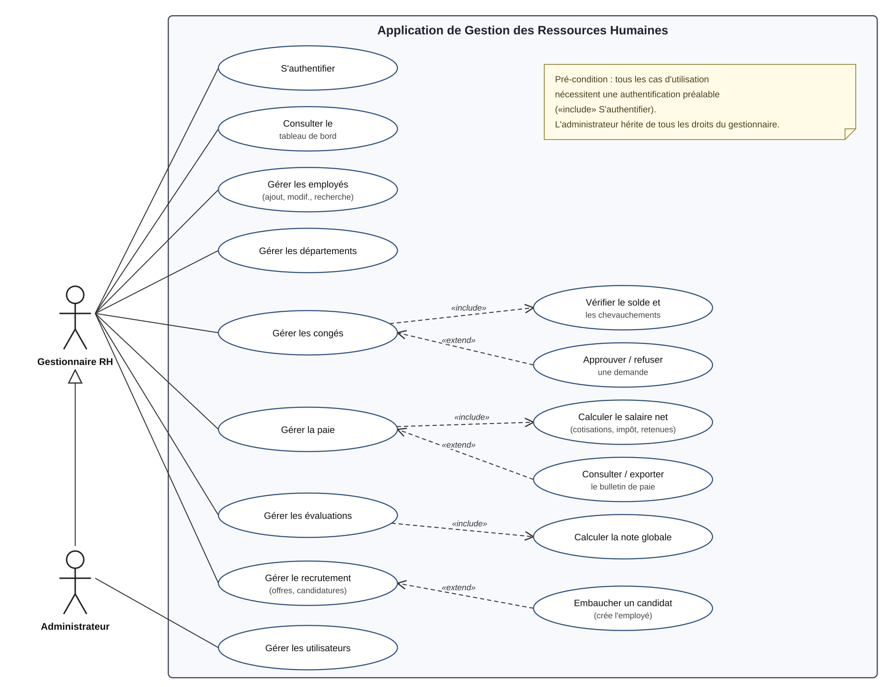
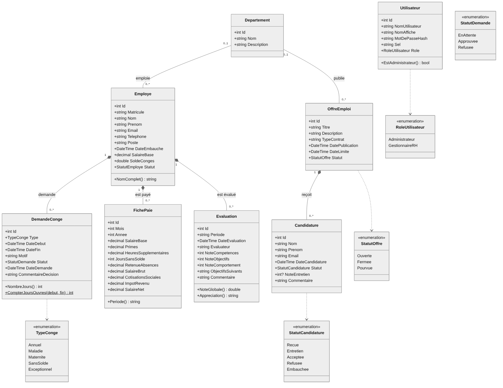
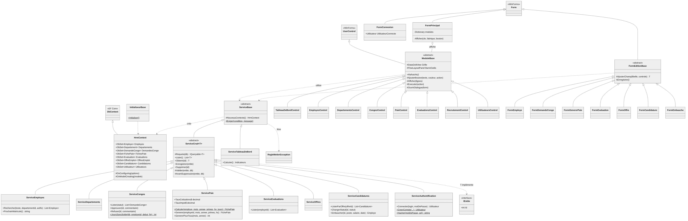
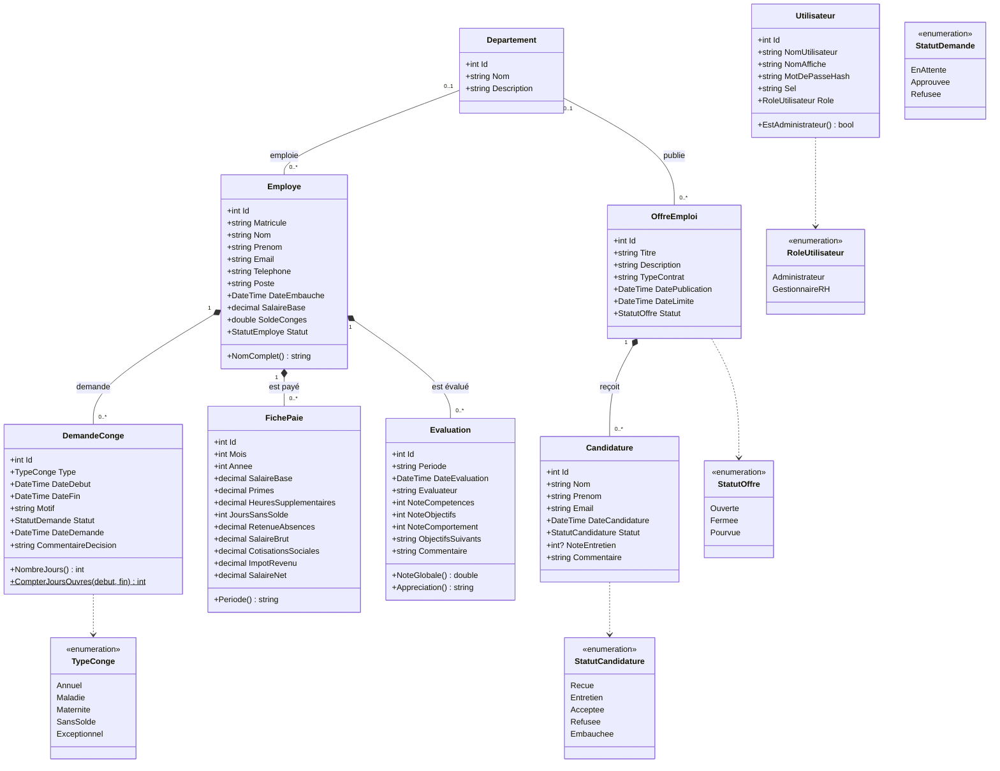

# Conception orientée objet — Gestion des Ressources Humaines

## 1. Diagramme de cas d'utilisation (général)

| Acteur | Rôle |
|---|---|
| **Gestionnaire RH** | Gère les employés, départements, congés, la paie, les évaluations et le recrutement ; consulte le tableau de bord. |
| **Administrateur** | Hérite de tous les cas du gestionnaire et gère en plus les comptes utilisateurs. |

Relations entre cas d'utilisation :

* **Gérer les congés** «include» *Vérifier le solde et les chevauchements* : à chaque demande, le système refuse
  une période qui chevauche une autre demande ou qui dépasse le solde (congé annuel).
* *Approuver / refuser une demande* «extend» **Gérer les congés** : l'approbation débite le solde.
* **Gérer la paie** «include» *Calculer le salaire net* (brut, retenue sans solde, cotisations, impôt).
* *Consulter / exporter le bulletin* «extend» **Gérer la paie**.
* **Gérer les évaluations** «include» *Calculer la note globale* (moyenne des 3 critères + appréciation).
* *Embaucher un candidat* «extend» **Gérer le recrutement** : crée automatiquement l'employé,
  marque la candidature « embauchée » et l'offre « pourvue ».

## 2. Diagramme de classes — modèle du domaine

Ces classes sont les **entités Entity Framework** : chacune devient une table de la base SQLite.

| Association | Multiplicité | Règle de suppression (EF Core) |
|---|---|---|
| Departement — Employe | 0..1 — 0..* | `SetNull` : l'employé reste, sans département |
| Employe ◆— DemandeConge / FichePaie / Evaluation | 1 — 0..* | `Cascade` (composition) |
| Departement — OffreEmploi | 0..1 — 0..* | `SetNull` |
| OffreEmploi ◆— Candidature | 1 — 0..* | `Cascade` (composition) |

Contraintes d'unicité : matricule d'employé, nom de département, nom d'utilisateur,
une seule fiche de paie par employé et par mois (index unique `EmployeId, Annee, Mois`).

## 3. Diagramme de classes — architecture (services et interfaces)

| Couche | Dossier | Classes |
|---|---|---|
| Modèle | `Modeles/` | `Employe`, `Departement`, `DemandeConge`, `FichePaie`, `Evaluation`, `OffreEmploi`, `Candidature`, `Utilisateur`, énumérations, interface `IEntite` |
| Accès aux données | `Donnees/` | `HrmContext` (hérite de `DbContext`), `InitialiseurBase` |
| Métier | `Services/` | `ServiceBase` → `ServiceCrud<T>` → un service par module ; `RegleMetierException` |
| Interface | `Vues/` | `FormConnexion`, `FormPrincipal`, `ModuleBase` → 8 modules, `FormEditionBase` → 9 fenêtres de saisie |

## 4. Principes orientés objet appliqués

* **Héritage et généricité** : `ServiceCrud<T>` (contrainte `where T : class, IEntite`) écrit une seule fois
  les opérations Lister / Obtenir / Enregistrer / Supprimer avec Entity Framework. Chaque service
  ne redéfinit que `Requete()` (jointures `Include`, tri) et `Valider()` (règles de gestion).
* **Polymorphisme** : `ModuleBase.Rafraichir()` et `FormEditionBase.Enregistrer()` sont abstraites ;
  la fenêtre principale manipule tous les écrans comme des `ModuleBase`.
* **Patron « méthode de gabarit »** : `ServiceCrud.Enregistrer()` appelle `Valider()` (redéfinie) avant
  d'enregistrer ; `FormEditionBase` gère les boutons et les erreurs, la classe fille ne fait que lire ses champs.
* **Encapsulation** : les règles (solde de congés, calcul de paie, embauche) sont dans les services,
  jamais dans les fenêtres. Le mot de passe n'est jamais stocké en clair (PBKDF2 + sel).
* **Interface** : `IEntite` garantit que toute entité a un `Id`, ce qui rend le CRUD générique possible.
* **Exception métier** : `RegleMetierException` transporte les messages destinés à l'utilisateur.

## 5. Sources des diagrammes de classes (Mermaid, affichées par GitHub)

```mermaid
classDiagram
    direction TB

    class HrmContext {
        +DbSet~Employe~ Employes
        +DbSet~Departement~ Departements
        +DbSet~DemandeConge~ DemandesConge
        +DbSet~FichePaie~ FichesPaie
        +DbSet~Evaluation~ Evaluations
        +DbSet~OffreEmploi~ OffresEmploi
        +DbSet~Candidature~ Candidatures
        +DbSet~Utilisateur~ Utilisateurs
        #OnConfiguring(options)
        #OnModelCreating(modele)
    }
    class DbContext {
        <<EF Core>>
    }
    class InitialiseurBase {
        +Initialiser()$
    }

    class ServiceBase {
        <<abstract>>
        #NouveauContexte() HrmContext
        #Exiger(condition, message)$
    }
    class ServiceCrud~T~ {
        <<abstract>>
        #Requete(db) IQueryable~T~
        +Lister() List~T~
        +Obtenir(id) T
        +Enregistrer(entite)
        +Supprimer(id)
        #Valider(entite, db)
        #AvantSuppression(entite, db)
    }
    class ServiceEmployes {
        +Rechercher(texte, departementId, actifs) List~Employe~
        +ProchainMatricule() string
    }
    class ServiceDepartements
    class ServiceConges {
        +Lister(statut) List~DemandeConge~
        +Approuver(id, commentaire)
        +Refuser(id, commentaire)
        +JoursSansSolde(db, employeId, debut, fin)$ int
    }
    class ServicePaie {
        +TauxCotisations$ decimal
        +TauxImpot$ decimal
        +Calculer(employe, mois, annee, primes, hs, jours)$ FichePaie
        +Generer(employeId, mois, annee, primes, hs) FichePaie
        +GenererPourTous(mois, annee) int
    }
    class ServiceEvaluations {
        +Lister(employeId) List~Evaluation~
    }
    class ServiceOffres
    class ServiceCandidatures {
        +ListerParOffre(offreId) List~Candidature~
        +ChangerStatut(id, statut)
        +Embaucher(id, poste, salaire, date) Employe
    }
    class ServiceAuthentification {
        +Connecter(login, motDePasse) Utilisateur
        +CreerCompte(...)$ Utilisateur
        +Hacher(motDePasse, sel)$ string
    }
    class ServiceTableauDeBord {
        +Calculer() Indicateurs
    }
    class RegleMetierException
    class IEntite {
        <<interface>>
        +int Id
    }

    class ModuleBase {
        <<abstract>>
        #DataGridView Grille
        #FlowLayoutPanel BarreOutils
        +Rafraichir()*
        #AjouterBouton(texte, couleur, action)
        #Afficher(lignes)
        #Executer(action)
        #OuvrirDialogue(form)
    }
    class FormEditionBase {
        <<abstract>>
        #AjouterChamp(libelle, controle) T
        #Enregistrer()*
    }
    class FormPrincipal {
        -Dictionary modules
        -Afficher(cle, fabrique, bouton)
    }
    class FormConnexion {
        +Utilisateur UtilisateurConnecte
    }
    class UserControl {
        <<WinForms>>
    }
    class Form {
        <<WinForms>>
    }

    DbContext <|-- HrmContext
    InitialiseurBase ..> HrmContext
    ServiceBase ..> HrmContext : crée
    ServiceBase <|-- ServiceCrud~T~
    ServiceBase <|-- ServiceTableauDeBord
    ServiceCrud~T~ <|-- ServiceEmployes
    ServiceCrud~T~ <|-- ServiceDepartements
    ServiceCrud~T~ <|-- ServiceConges
    ServiceCrud~T~ <|-- ServicePaie
    ServiceCrud~T~ <|-- ServiceEvaluations
    ServiceCrud~T~ <|-- ServiceOffres
    ServiceCrud~T~ <|-- ServiceCandidatures
    ServiceCrud~T~ <|-- ServiceAuthentification
    ServiceBase ..> RegleMetierException : lève
    ServiceCrud~T~ ..> IEntite : T implémente

    UserControl <|-- ModuleBase
    Form <|-- FormEditionBase
    Form <|-- FormPrincipal
    Form <|-- FormConnexion
    ModuleBase <|-- TableauDeBordControl
    ModuleBase <|-- EmployesControl
    ModuleBase <|-- DepartementsControl
    ModuleBase <|-- CongesControl
    ModuleBase <|-- PaieControl
    ModuleBase <|-- EvaluationsControl
    ModuleBase <|-- RecrutementControl
    ModuleBase <|-- UtilisateursControl
    FormEditionBase <|-- FormEmploye
    FormEditionBase <|-- FormDemandeConge
    FormEditionBase <|-- FormGenererPaie
    FormEditionBase <|-- FormEvaluation
    FormEditionBase <|-- FormOffre
    FormEditionBase <|-- FormCandidature
    FormEditionBase <|-- FormEmbauche
    FormPrincipal o-- ModuleBase : affiche
    ModuleBase ..> ServiceBase : utilise
    FormEditionBase ..> ServiceBase : utilise
```

